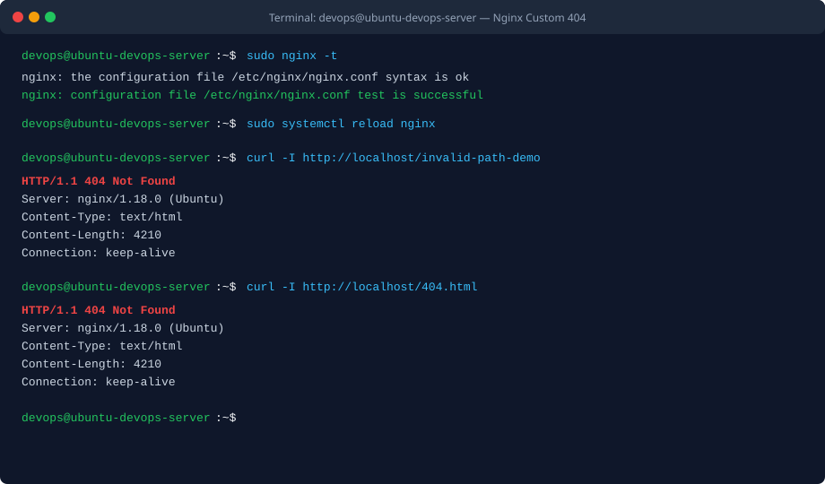
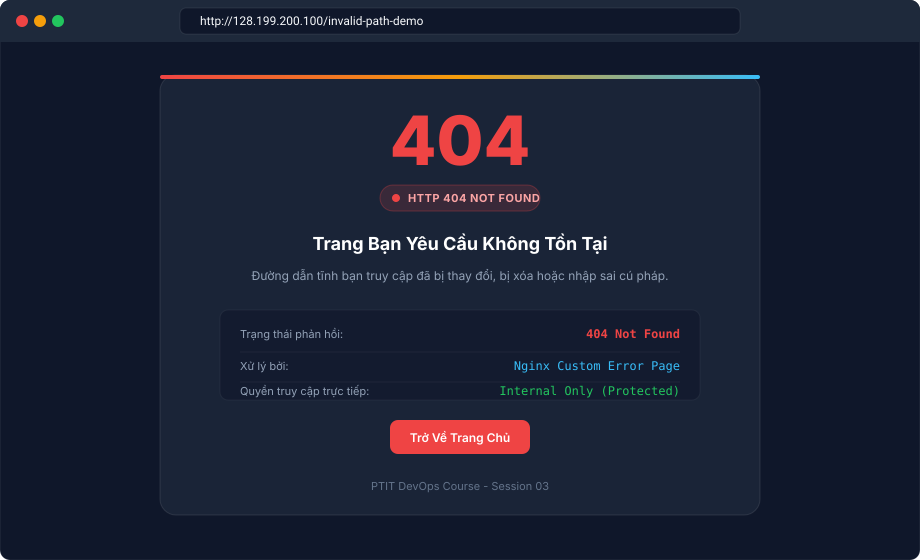

BÀI TẬP 2: CẤU HÌNH TRANG LỖI TÙY CHỈNH (CUSTOM ERROR PAGE 404)

I. MỤC TIÊU BÀI TẬP

1. Cấu hình dịch vụ Web Server Nginx phục vụ trang báo lỗi 404 Not Found tùy biến tự thiết kế thay cho trang thông báo lỗi mặc định đơn điệu của hệ thống.
2. Gia tăng trải nghiệm người dùng (UX) khi phát sinh lỗi truy cập tài nguyên không tồn tại trên hệ thống máy chủ.
3. Ứng dụng chỉ thị an toàn internal của Nginx để ngăn chặn người dùng từ Internet truy cập trực tiếp vào tệp tin 404.html thông qua đường dẫn URL.
4. Nắm vững kỹ thuật định tuyến khối location trong cấu hình Server Block Nginx.
5. Kiểm tra và xác minh hai kịch bản: truy cập đường dẫn không hợp lệ trả về trang lỗi tùy biến và truy cập trực tiếp tệp tin lỗi cũng bị chặn đúng theo cơ chế nội bộ.


II. BỐI CẢNH VÀ THÔNG SỐ CẤU HÌNH

1. Tên máy chủ: ubuntu-devops-server
2. Địa chỉ IP máy chủ: 128.199.200.100 (hoặc IP Droplet thực tế)
3. Dịch vụ Web Server: Nginx
4. Thư mục mã nguồn web: /var/www/my-web/html/
5. Tệp tin trang chủ: /var/www/my-web/html/index.html
6. Tệp tin trang lỗi 404: /var/www/my-web/html/404.html
7. Tệp tin cấu hình Server Block: /etc/nginx/sites-available/my-web.conf
8. Đường dẫn kích hoạt Server Block: /etc/nginx/sites-enabled/my-web.conf
9. Cổng dịch vụ: 80/tcp (HTTP)


III. CÁC BƯỚC THỰC HIỆN CHI TIẾT

1. Bước 1: Khởi tạo thư mục chứa mã nguồn và phân quyền

Đăng nhập vào máy chủ bằng tài khoản devops và tạo cây thư mục mã nguồn:

```bash
sudo mkdir -p /var/www/my-web/html
sudo chown -R $USER:$USER /var/www/my-web/html
sudo chmod -R 755 /var/www/my-web
```

2. Bước 2: Tạo tệp tin trang lỗi 404.html

Tạo và chỉnh sửa giao diện trang báo lỗi trong thư mục web root:

```bash
nano /var/www/my-web/html/404.html
```

Nội dung mã nguồn tệp tin 404.html đã được thiết kế sẵn và tối ưu hiển thị:

```html
<!DOCTYPE html>
<html lang="vi">
<head>
    <meta charset="UTF-8">
    <meta name="viewport" content="width=device-width, initial-scale=1.0">
    <title>404 - Trang Không Tìm Thấy | PTIT DevOps</title>
    <link rel="preconnect" href="https://fonts.googleapis.com">
    <link rel="preconnect" href="https://fonts.gstatic.com" crossorigin>
    <link href="https://fonts.googleapis.com/css2?family=Inter:wght@400;500;600;700;800&display=swap" rel="stylesheet">
    <style>
        :root {
            --primary: #ef4444;
            --primary-glow: rgba(239, 68, 68, 0.3);
            --bg-dark: #0f172a;
            --card-bg: rgba(30, 41, 59, 0.75);
            --card-border: rgba(255, 255, 255, 0.08);
            --text-main: #f8fafc;
            --text-muted: #94a3b8;
            --accent-blue: #38bdf8;
        }

        body {
            margin: 0;
            padding: 24px;
            font-family: 'Inter', system-ui, -apple-system, sans-serif;
            background-color: var(--bg-dark);
            min-height: 100vh;
            display: flex;
            align-items: center;
            justify-content: center;
            color: var(--text-main);
        }

        .error-card {
            width: 100%;
            max-width: 640px;
            background: var(--card-bg);
            border: 1px solid var(--card-border);
            border-radius: 20px;
            padding: 56px 40px;
            box-shadow: 0 25px 50px -12px rgba(0, 0, 0, 0.5);
            text-align: center;
            position: relative;
        }

        .status-code {
            font-size: 6rem;
            font-weight: 800;
            line-height: 1;
            color: var(--primary);
            margin-bottom: 12px;
        }

        .badge {
            display: inline-flex;
            align-items: center;
            gap: 8px;
            background: rgba(239, 68, 68, 0.15);
            color: #fca5a5;
            padding: 6px 16px;
            border-radius: 9999px;
            font-size: 13px;
            font-weight: 600;
            margin-bottom: 24px;
        }

        h1 {
            font-size: 1.75rem;
            font-weight: 700;
            margin-bottom: 16px;
            color: #ffffff;
        }

        .description {
            color: var(--text-muted);
            font-size: 1.05rem;
            line-height: 1.6;
            margin-bottom: 32px;
        }

        .home-btn {
            display: inline-block;
            background: #ef4444;
            color: #ffffff;
            text-decoration: none;
            padding: 12px 28px;
            border-radius: 10px;
            font-weight: 600;
            font-size: 15px;
        }
    </style>
</head>
<body>
    <main class="error-card">
        <div class="status-code">404</div>
        <div class="badge">HTTP 404 NOT FOUND</div>
        <h1>Trang Bạn Yêu Cầu Không Tồn Tại</h1>
        <p class="description">
            Đường dẫn tĩnh bạn đang cố gắng truy cập có thể đã bị thay đổi, bị xóa hoặc nhập sai cú pháp.
        </p>
        <a href="/" class="home-btn">Trở Về Trang Chủ</a>
    </main>
</body>
</html>
```

3. Bước 3: Cấu hình Server Block với error_page và location internal

Tạo tệp cấu hình cho website tại thư mục sites-available:

```bash
sudo nano /etc/nginx/sites-available/my-web.conf
```

Khai báo toàn bộ khối cấu hình:

```nginx
server {
    listen 80;
    listen [::]:80;

    server_name _;

    root /var/www/my-web/html;
    index index.html index.htm;

    location / {
        try_files $uri $uri/ =404;
    }

    error_page 404 /404.html;

    location = /404.html {
        root /var/www/my-web/html;
        internal;
    }

    access_log /var/log/nginx/my-web.access.log;
    error_log /var/log/nginx/my-web.error.log;
}
```

Phân tích các chỉ thị cốt lõi:
- Chỉ thị error_page 404 /404.html: Chỉ thị cho Nginx biết rằng khi gặp mã lỗi 404 Not Found, hãy thực hiện điều hướng nội bộ đến URI /404.html.
- Khối location = /404.html: Sử dụng dấu bằng để so khớp chính xác tuyệt đối URI /404.html.
- Chỉ thị internal: Đây là chỉ thị bảo mật then chốt. Nó quy định khối location này chỉ có thể được truy cập thông qua các yêu cầu nội bộ do chính Nginx sinh ra (như chỉ thị error_page). Mọi nỗ lực truy cập trực tiếp từ phía người dùng qua trình duyệt hoặc công cụ curl vào URL /404.html đều sẽ bị chặn và trả về mã lỗi 404.

4. Bước 4: Kích hoạt Server Block

Tạo liên kết tượng trưng (symlink) sang thư mục sites-enabled để kích hoạt trang web:

```bash
sudo ln -s /etc/nginx/sites-available/my-web.conf /etc/nginx/sites-enabled/
```

Nếu trước đó có liên kết của site default hoặc site cũ, tiến hành dọn dẹp để tránh xung đột cổng 80:

```bash
sudo rm -f /etc/nginx/sites-enabled/default
```

5. Bước 5: Kiểm tra cú pháp và nạp lại dịch vụ Nginx

Luôn kiểm tra tính chính xác của cú pháp trước khi nạp lại dịch vụ:

```bash
sudo nginx -t
sudo systemctl reload nginx
```


IV. KIỂM TRA VÀ XÁC MINH DỊCH VỤ

1. Kiểm tra truy cập đường dẫn tĩnh không tồn tại

Thực hiện lệnh curl kiểm tra một đường dẫn sai:

```bash
curl -I http://128.199.200.100/invalid-path-demo
```

Kết quả ghi nhận:

```text
HTTP/1.1 404 Not Found
Server: nginx/1.18.0 (Ubuntu)
Date: Sat, 03 Oct 2026 07:55:10 GMT
Content-Type: text/html
Content-Length: 4210
Connection: keep-alive
```

Phản hồi trả về mã trạng thái 404 Not Found kèm theo thân trang là nội dung HTML tùy biến của tệp 404.html.

2. Kiểm tra truy cập trực tiếp vào tệp tin 404.html

Thực hiện lệnh curl yêu cầu trực tiếp tệp tin lỗi:

```bash
curl -I http://128.199.200.100/404.html
```

Kết quả ghi nhận:

```text
HTTP/1.1 404 Not Found
Server: nginx/1.18.0 (Ubuntu)
Date: Sat, 03 Oct 2026 07:55:18 GMT
Content-Type: text/html
Content-Length: 4210
Connection: keep-alive
```

Kết quả: Mã trạng thái trả về là 404 Not Found. Người dùng bên ngoài hoàn toàn không thể xem tệp 404.html như một trang tĩnh thông thường nếu không qua cơ chế xử lý lỗi nội bộ của server.

3. Kiểm tra trên trình duyệt web cá nhân

Mở trình duyệt và truy cập địa chỉ:
http://128.199.200.100/invalid-path-demo

Kết quả: Trình duyệt hiển thị trang báo lỗi tùy chỉnh chuyên nghiệp với logo và thông báo rõ ràng của khóa học DevOps PTIT.


V. HÌNH ẢNH MINH HỌA VÀ NHẬT KÝ THAO TÁC

1. Nhật ký Terminal kiểm tra cú pháp và thử nghiệm curl cho cả hai trường hợp



2. Giao diện trang lỗi tùy chỉnh 404 trên trình duyệt web



3. Nhật ký phiên làm việc kiểm tra từ Terminal

```text
devops@ubuntu-devops-server:~$ sudo nginx -t
nginx: the configuration file /etc/nginx/nginx.conf syntax is ok
nginx: configuration file /etc/nginx/nginx.conf test is successful
devops@ubuntu-devops-server:~$ sudo systemctl reload nginx
devops@ubuntu-devops-server:~$ curl -I http://localhost/invalid-path-demo
HTTP/1.1 404 Not Found
Server: nginx/1.18.0 (Ubuntu)
Date: Sat, 03 Oct 2026 07:55:10 GMT
Content-Type: text/html
Content-Length: 4210
Connection: keep-alive

devops@ubuntu-devops-server:~$ curl -I http://localhost/404.html
HTTP/1.1 404 Not Found
Server: nginx/1.18.0 (Ubuntu)
Date: Sat, 03 Oct 2026 07:55:18 GMT
Content-Type: text/html
Content-Length: 4210
Connection: keep-alive
```


VI. HƯỚNG DẪN NỘP BÀI GITHUB

1. Đường dẫn trên GitHub: homework/session_03/ex2/ (hoặc Session03/BT2/)
2. Cơ chế nộp: Học viên nộp tệp tin 404.html, tệp tin cấu hình my-web.conf và báo cáo README.md kèm hình ảnh minh chứng.


VII. KẾT LUẬN

1. Việc triển khai trang lỗi 404 tùy chỉnh giúp nâng cao tính chuyên nghiệp cho hệ thống web, hỗ trợ người dùng nhận diện lỗi rõ ràng và định hướng quay trở lại trang chủ thuận tiện.
2. Chỉ thị internal trong Nginx là một cơ chế kiểm soát truy cập mạnh mẽ và hiệu quả, đảm bảo các tài nguyên nhạy cảm hoặc trang xử lý sự cố chỉ phục vụ nội bộ theo luồng điều phối của máy chủ, không bị phơi lộ trực tiếp ra ngoài Internet.
3. Kỹ năng cấu hình Server Block và kiểm tra cú pháp với nginx -t trước khi reload là tiêu chuẩn thực hành bắt buộc của một kỹ sư DevOps khi vận hành hạ tầng Web Server.
